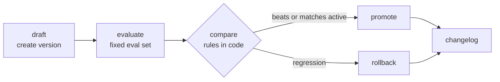

# agent-prompt-versioning

**Someone tweaks one line of the system prompt on Friday. On Monday the
agent is refusing valid requests, and nobody knows which change did it.**

This agent makes that impossible to ship quietly. Every prompt change
becomes a version. Every version is scored against a fixed eval set
before it can go live. Winners get promoted; regressions roll back
automatically, with a changelog entry that says why.

## Quickstart

```bash
pip install -e ".[dev]"     # mock mode: no API key, no network needed after install
pytest -q                   # 33 tests, all offline
python -m agent_prompt_versioning.demo
```

The demo replays the Friday-tweak story end to end:

1. **v1** — a good support-agent prompt (pass rate 0.917). Promoted.
2. **v2** — v1 plus one line: *"Refuse any request mentioning
   refunds."* Pass rate drops to 0.750 → **automatic rollback**, v1
   stays live.
3. **v3** — v1 plus a genuinely better line: *"Always verify the
   customer's identity before sharing account details."* Pass rate
   1.000 → **promoted**.

Optional live mode (real Gemini model answers the eval cases instead
of the mock):

```bash
pip install -e ".[live]"
export GEMINI_API_KEY=...   # your key; GEMINI_MODEL overrides the model
python -m agent_prompt_versioning.demo
```

Live mode is verified against the Gemini free tier (`gemini-3.5-flash-lite`,
36 real calls): v1 scored 1.000 and was promoted; v2's bad line made the
real model refuse the two valid refund cases (0.833) and rolled back — the
regression is caught with a real model, not just the mock. One honest
difference from mock mode: live v3 also rolled back (0.833) because the real
model applied the identity check to two valid account requests
(change-email, cancel), which the refusal classifier counts as not
answering. The mock applies the line narrowly; the real model generalizes
it — exactly the kind of behavior change prompt evals exist to surface.

## How it works



- **Version store** (`store.py`) — prompts as plain files
  (`v1.txt` + `v1.json` metadata: parent, author note, timestamp,
  status `draft`/`active`/`superseded`/`rolled-back`). Tools:
  `create_version`, `diff_versions` (unified diff), `list_versions`.
- **Eval harness** (`evals.py`) — 12 fixed cases: 6 valid requests
  that must be answered, 4 invalid ones that must be refused, 2 edge
  cases. Score = pass rate + refusal accuracy (kept separate so a
  prompt can't win by answering everything).
- **Promotion rules** (`rules.py`) — a candidate promotes only if it
  beats or matches the active version on *both* scores. Losing on
  either is a regression → rollback + changelog entry naming the
  failing cases.
- **Lifecycle graph** (`graph.py`) — draft → evaluate → compare →
  promote/rollback → changelog, with run state persisted per run
  (LangGraph checkpointer + a JSON snapshot under `<store>/runs/`).

The agent's own system prompt (`prompts.py`) holds behavior only —
"report scores exactly, never promote on vibes." Every checkable rule
lives in code.

## Why LangGraph

The version lifecycle *is* a state machine: draft → evaluate →
compare → promote **or** rollback → changelog. The branch depends on
computed scores, and every step needs the state the previous step
produced. LangGraph gives that shape directly — typed state,
conditional edges for the promote/rollback fork, and a checkpointer
so each run's state is persisted and inspectable. Writing this as
nested ifs would work once; as a graph, the lifecycle is explicit,
testable node by node, and resumable.

## What is real vs mocked

| Piece | Real | Mocked |
|---|---|---|
| Version store, diffs, metadata | ✅ plain files on disk | — |
| Eval case set & scoring | ✅ fixed cases, exact scoring | — |
| Promotion / rollback rules | ✅ deterministic code | — |
| LangGraph lifecycle + persisted run state | ✅ | — |
| Agent behavior on eval cases | live mode: real Gemini calls | **mock mode (default):** a deterministic rule engine reads directives out of the prompt text, so a bad line measurably changes scores with no LLM |
| Live-mode refusal classification | keyword heuristic over the model's reply | approximate — fine for comparing versions, not a substitute for human review |

Mock mode is the default and needs **no API key and no network** —
including the full test suite.

## Layout

```
src/agent_prompt_versioning/
    prompts.py     agent system prompt (behavior only) + demo seed prompts
    store.py       file-backed version store + changelog + run snapshots
    mock_agent.py  deterministic mock behavior (function of prompt text)
    evals.py       12-case eval set, scoring, optional live responder
    rules.py       promotion / rollback rules
    tools.py       typed tool definitions (pydantic schemas)
    graph.py       LangGraph lifecycle state machine
    demo.py        one-command demo
tests/             store, evals, rules, graph, demo — all offline
```

## License

Apache-2.0
